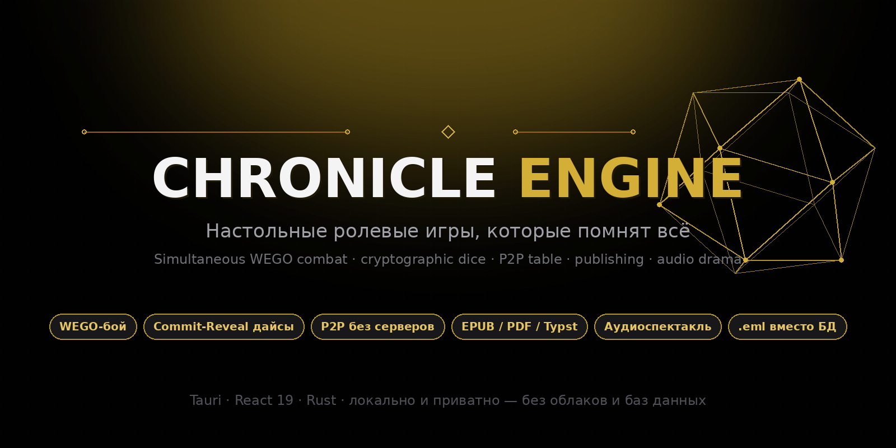
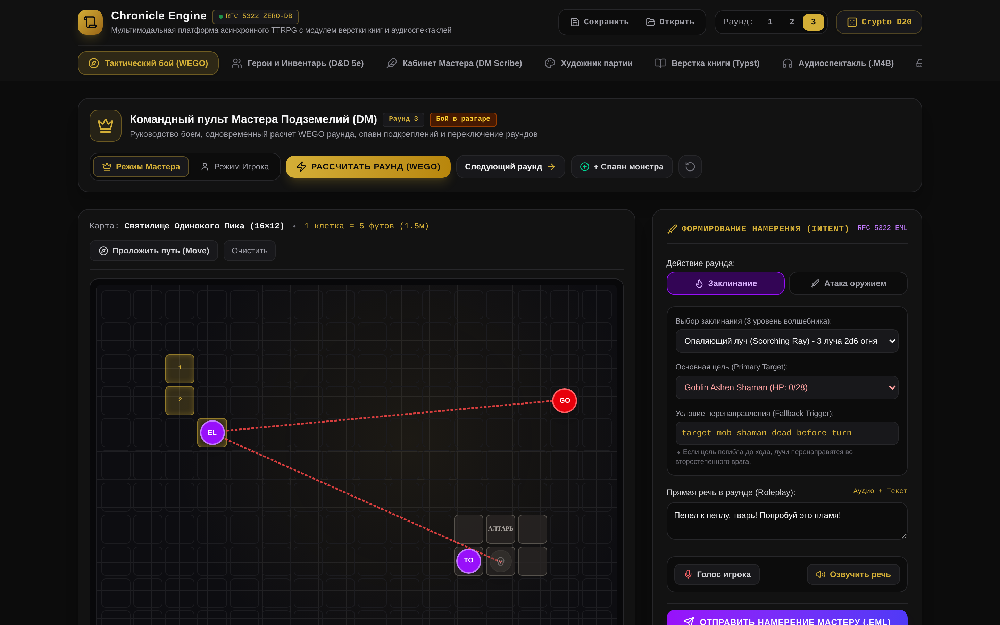
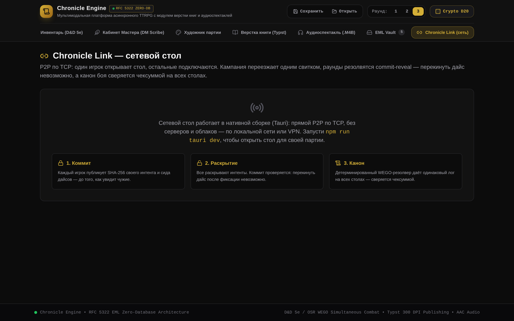
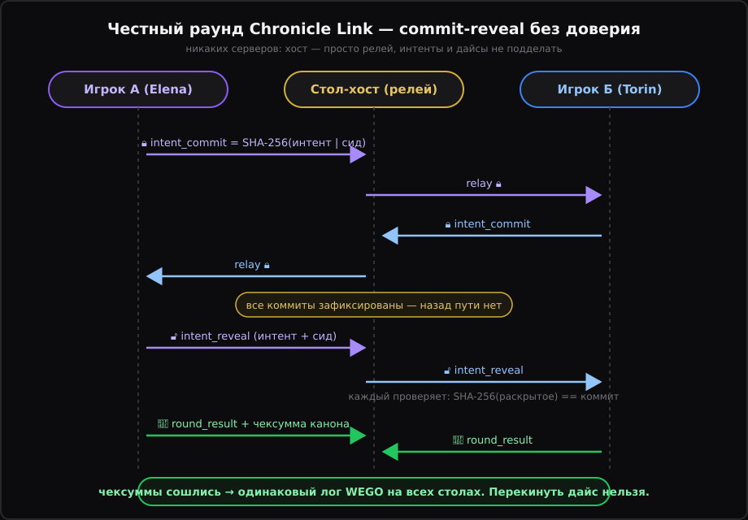
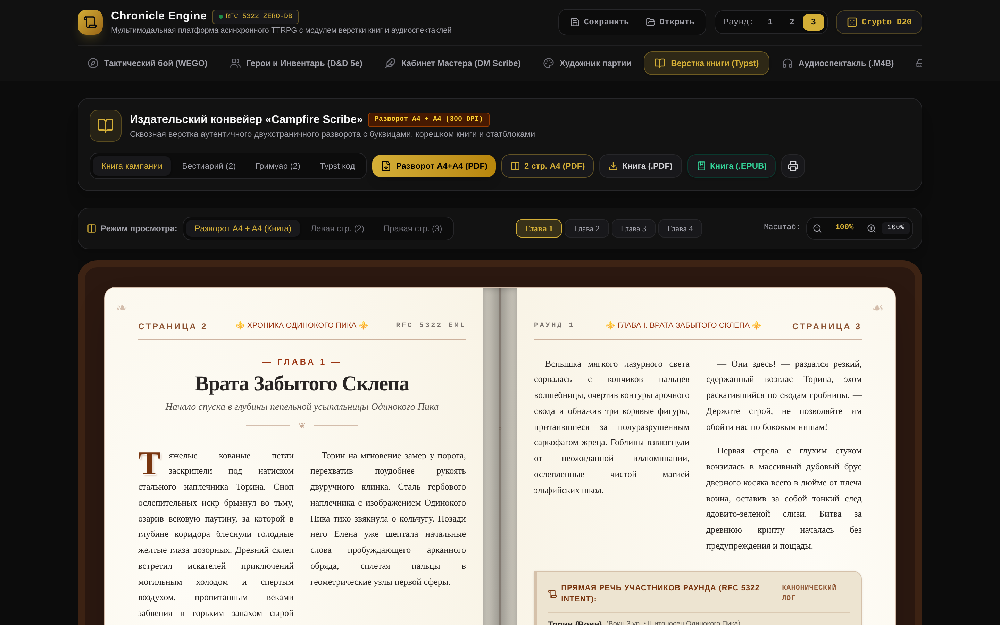
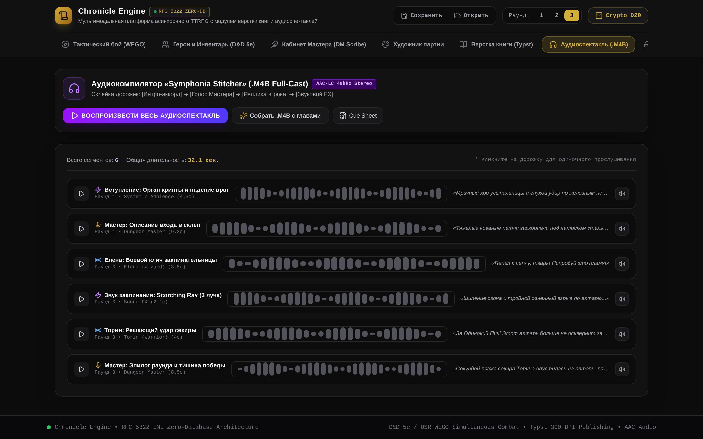
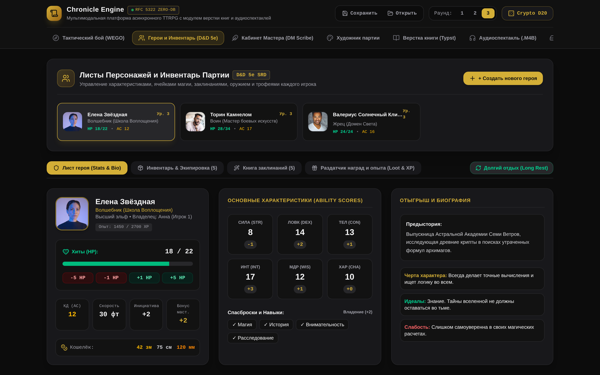

<div align="center">



# Chronicle Engine

**Tabletop RPGs that remember everything.**
Simultaneous WEGO combat · cryptographic dice you can't reroll · a serverless networked table ·
book publishing · audio drama — all on your machine, zero clouds.

[](https://github.com/kostyk348/chronicle-engine/releases)
[](https://github.com/kostyk348/chronicle-engine/actions/workflows/ci.yml)
[](#-quality-under-a-microscope)
[](LICENSE)

**[Русский](README.md)** · [Download](https://github.com/kostyk348/chronicle-engine/releases) · [CHANGELOG](CHANGELOG.md)

</div>

---

## Why another tabletop engine

Because existing platforms play **for** you. Turn-based initiative drags a fight into hours of bookkeeping,
your data lives on someone else's server, and the "dice" are `Math.random()` nobody can audit.

Chronicle Engine stands on four principles:

- **Simultaneous turns (WEGO).** Everyone plans — then everything resolves. Ambushes, counterspells and reaction duels emerge naturally, no initiative ladder.
- **Cryptography instead of trust.** Every d20 is HMAC-SHA256 of the player's seed and the master's seed. You can't reroll a round, and you can always audit a log.
- **Zero servers.** The campaign is a file. The networked table is a direct P2P connection. No subscriptions, no accounts, no "cloud temporarily unavailable".
- **The chronicle is the product.** Every session typesets into a book (EPUB 3.0 / PDF / Typst) and is performed as an audio drama. Your campaign doesn't evaporate — it ships.

## Not a token board — a chronicle machine

### ⚔️ Tactical WEGO resolver



A five-phase round that is fully deterministic: same intents + same seed produce a **bit-identical log on any machine**.

1. **Validation** — dead actors and unreachable targets are cut.
2. **Movement** — everyone moves at once; speed caps, dash ×2, walls and occupied tiles block steps.
3. **Actions** — weapons read from character data (damage dice + to-hit bonus), spells from the spellbook: Scorching Ray by slot level, auto-hitting Magic Missile, Shield.
4. **Reactions** — Shield triggers on any incoming attack; Dodge imposes disadvantage, Help grants an ally advantage.
5. **Outcome** — Victory / Defeat / Fled, plus deterministic narrative prose for the chronicle.

Bonus: the Fallback rule — if a ray's target falls in the same round, the shot auto-redirects per a pre-declared rule.

**Cinematic replay.** Every resolved round decomposes into machine-readable events, and the tactical board plays them back: tokens glide across tiles, attack arcs flash between combatants, damage pops as floating numbers, crits burn gold — and crits and deaths shake the whole table with deterministic sparks (same round → same fireworks on every machine). Pause, frame step, ×1–×4 speed, instant skip. Master pins (`Alt+click`) place labeled markers on a shared map layer — place one at your table and every table sees it. XP for slain enemies flows straight into party sheets.

**D&D Beyond import.** Paste a character's JSON export — the parser survives a full DDB dump and a flat `{name, level, hp, ac, str, ...}` sheet, recomputes modifiers/proficiency/spell slots per 5e rules, and honestly reports in warnings everything it had to assume.

### 🔐 Dice you can believe

Every roll is a commit-reveal:

```
d20 = (HMAC-SHA256(player_seed, master_seed) mod 20) + 1
```

- The player **can't reroll**: the seed is locked before the roll.
- The master **can't peek**: their half of the key is revealed simultaneously.
- Nat 20 doubles damage dice; nat 1 misses regardless of bonuses.
- Damage, advantage/disadvantage (two salted d20s) and AI decisions come from a deterministic `HMAC(key, msg:idx)` uint32 stream with rejection sampling — no modulo bias.

### 🌐 Chronicle Link — a serverless table



One player hosts; everyone else joins over LAN or VPN. The transport is plain TCP on `std::net` inside the Rust backend — **no network libraries, no cloud services**.

- **The campaign travels as one scroll**: join and receive the whole archive — chapters, bestiary, combat state.
- **Roster and table chat** — who's online and which actors they run.
- **Fair rounds via commit-reveal**: intent hashes first, reveals second, canonical checksums last.

- **Live map**: tokens are dragged with the mouse and the position instantly reaches every player as a validated `token_move` message. The master moves any token, a player — only their own; out-of-bounds cells and garbage frames are dropped at the protocol boundary, and echoes never relay.



| Cheat attempt | What stops it |
|---|---|
| Rerolling a bad d20 | The seed is locked in `intent_commit` before the reveal; mismatch is detected automatically |
| Changing an intent after seeing others | Everyone already holds the commit hash — the reveal must match |
| A rigged host | The host only relays; every table resolves the round itself and compares checksums |
| "My log is different, trust me" | The resolver is deterministic: divergent checksum = divergent data, visible to all |

### 📖 Publishing house



Two-column A4 spreads with illuminated drop caps, Master's margin notes and bestiary stat blocks. Export to EPUB 3.0 (structured `nav.xhtml`), print-ready PDF, and **Typst** source for real print shops.

### 🎭 Audio drama with zero samples



Character lines are synthesized with individual voices; tavern and dungeon ambience is pure Web Audio API FM synthesis with reverb, arranged into tracks. The repo contains no binary audio files at all.

### 🧙 Everything else the table needs



D&D 5e character sheets with inventory and spells, a DM Scribe scene studio, a party artist, the cryptographic dice modal and the **EML Vault** campaign scroll browser.

## 🚀 Install

Grab a binary from [Releases](https://github.com/kostyk348/chronicle-engine/releases) — unpack and run.
Building from source: Rust 1.77+ and Node 18+ (`webkit2gtk-4.1` on Linux, WebView2 on Windows).

```bash
git clone https://github.com/kostyk348/chronicle-engine
cd chronicle-engine && npm install
npm run tauri dev     # native window
npm run tauri build   # binary + bundles
npm run dev           # plain web mode
```

## 🧪 Quality under a microscope

| Layer | Check | Coverage |
|---|---|---|
| TypeScript | 69 tests (Vitest) | WEGO: determinism, phases, crit/fumble, fallback, shield, dodge/help, round events, replay timeline; Link: canonical JSON, commit-reveal, phase machine, anti-cheat, `token_move` validation; D&D Beyond import; particles/shake determinism |
| Rust | 11 tests + clippy `-D warnings` | Transport: framing, oversize rejection, commit→reveal relay between two clients, scroll in welcome, duplicate-name suffixing, canonical JSON |
| CI | GitHub Actions | web job (lint → test → build) + rust job (cargo test → clippy); canonical JSON is mirrored by tests on both sides |

## 📄 License

MIT — play, hack, publish. [LICENSE](LICENSE)

<div align="center">
<sub>Chronicle Engine — the engine after which every party has a book.</sub>
</div>

**Gray screen on Linux startup?** Fixed since 1.6.1: the engine sets `WEBKIT_DISABLE_DMABUF_RENDERER=1` itself (WebKitGTK compositing breaks on NVIDIA and some Mesa builds). Since 1.6.5, if the Mesa vendor JSON is missing (typical after an NVIDIA `.run` installer), the app generates its own GLVND vendor JSON pointing at the system `libEGL_mesa.so.0`, so software EGL comes up even on such systems; if Mesa-EGL is absent entirely, the log prints the exact fix: `sudo apt install libegl-mesa0 libgl1-mesa-dri`. For older builds or VMs: prefix the AppImage run with `WEBKIT_DISABLE_DMABUF_RENDERER=1` or `LIBGL_ALWAYS_SOFTWARE=1`.
