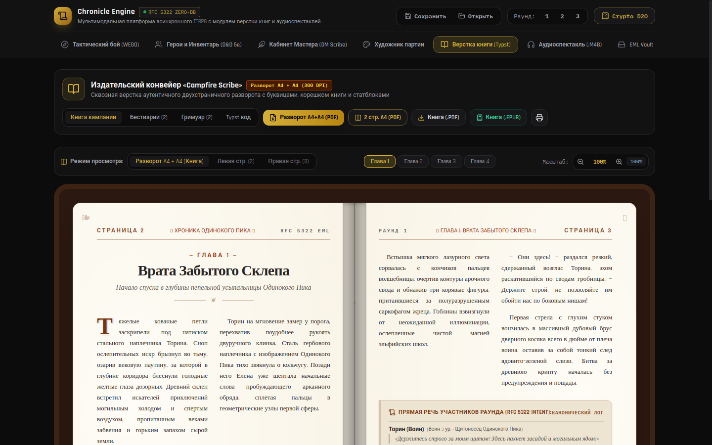

# 📜 Chronicle Engine — Campfire Scribe (Native Desktop)

> **Мультимодальная платформа для асинхронных настольных ролевых игр (TTRPG / D&D 5e)** с архитектурой «Zero-Database» на базе RFC 5322 EML, тактическим движком одновременных ходов **WEGO**, издательским модулем верстки книг (**Typst / PDF / EPUB 3.0**) и многоголосым аудиоспектаклем.

**Нативная десктопная сборка (Tauri + React 19 + TypeScript)** — настоящее окно, файловая система, без браузера и без серверов.


[](https://github.com/kostyk348/chronicle-engine/releases)
[](https://github.com/kostyk348/chronicle-engine/commits/main)

---

## ✨ Возможности

### 📬 Архитектура «Zero-Database» (RFC 5322 EML)

- Всё состояние кампании — переписка, ходы, инвентарь, раунды боя — кодируется в стандартные почтовые свитки `.eml`.
- Парсер заголовков: `Message-ID`, `In-Reply-To`, `X-TTRPG-Round`, `X-TTRPG-HP`, `X-TTRPG-Checksum-SHA256`.
- Валидация целостности данных партии и мгновенный импорт/экспорт архивов ходов.

### ⚔️ Тактический боевой резолвер WEGO

- Одновременное разрешение ходов (Simultaneous Execution) вместо пошаговой инициативы.
- Парирования, контрзаклинания, прерывания, Advantage/Disadvantage по D&D 5e SRD.
- Криптографический генератор бросков d20/d12/d10/d8/d6/d4 с расчетом критических попаданий и промахов.

### 📖 Издательский цех верстки (Book Preview Studio)

- Двухколоночный разворот A4, иллюминированные буквицы, заметки Мастера, стат-блоки бестиария.
- **Экспорт EPUB 3.0**: структурированное оглавление (`nav.xhtml`), бестиарий, гримуар.
- **Векторный PDF**: нативная печать и экспорт через jsPDF.
- Генерация исходного кода **Typst** для полиграфической компиляции.

### 🎭 Аудиоспектакль

- Синтез многоголосых реплик персонажей с индивидуальными тембрами и реверберацией.
- Фоновые эмбиенты таверны, подземелья, битвы — Web Audio API без внешних сэмплов.

### 💾 Настоящая файловая персистентность

- **Автосохранение кампании** в JSON-файл (`~/.local/share/com.chronicle.engine/campaign.json`) при каждом изменении.
- Кнопки **Сохранить / Открыть** в шапке — нативные диалоги для переноса кампаний между машинами.
- **EPUB/PDF экспорт через нативные диалоги** — реальные файлы на диске, а не скачивание в браузере.

---

## 🚀 Запуск

### Требования

- [Rust](https://rustup.rs/) 1.77+ · [Node.js](https://nodejs.org/) 18+
- Linux: `webkit2gtk-4.1`, `gtk3`, `librsvg` · Windows: WebView2 · macOS: WebKit

### Разработка

```bash
npm install
npm run tauri dev
```

### Сборка нативного бинаря

```bash
npm run tauri build
# Бинарь: src-tauri/target/release/chronicle-engine
# Пакеты: src-tauri/target/release/bundle/

```

### Просто веб-режим

```bash
npm install
npm run dev   # Vite dev-сервер на :5173
npm run build && npm run preview
```

---

## 🧠 Как это устроено

| Модуль | Назначение |
|---|---|
| `src/utils/mimeEml.ts` | RFC 5322 EML-криптосвитки кампании |
| `src/utils/wegoResolver.ts` | Движок одновременного разрешения боя WEGO |
| `src/utils/cryptoDice.ts` | Криптографические броски d20…d4 |
| `src/utils/epubExporter.ts` | Экспорт EPUB 3.0 (JSZip) |
| `src/utils/pdfExporter.ts` | Экспорт PDF (jsPDF + html2canvas) |
| `src/utils/audioSynthesizer.ts` | FM/субтрактивный синтез SFX и речи |
| `src/utils/desktopIO.ts` | Мост к нативной ФС через Tauri IPC |
| `src-tauri/src/lib.rs` | Rust-бэкенд: файловые команды, нативные диалоги |

---

## 📄 Лицензия

MIT
