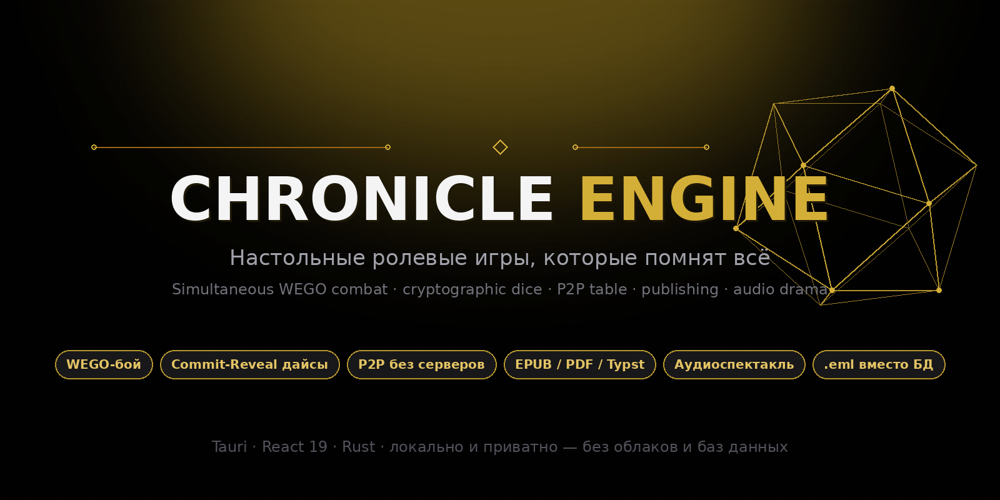
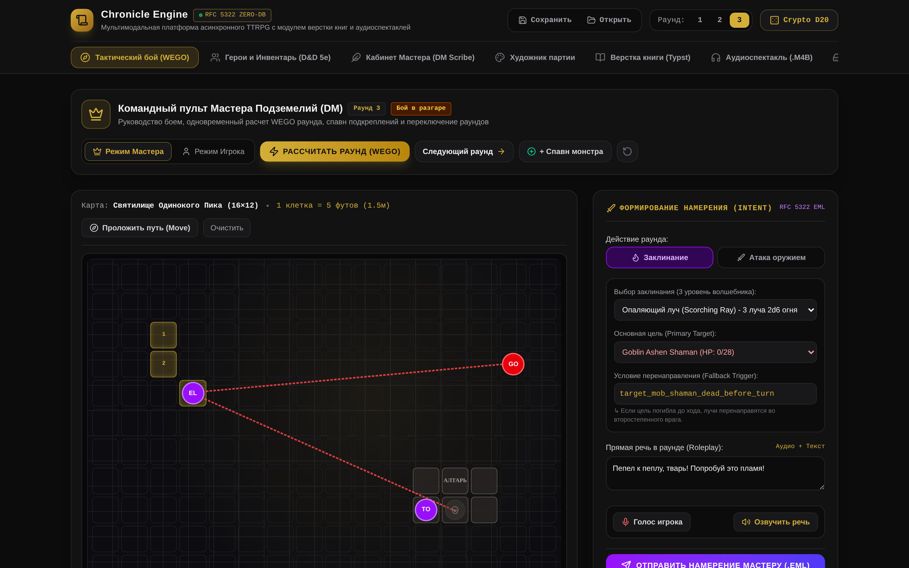
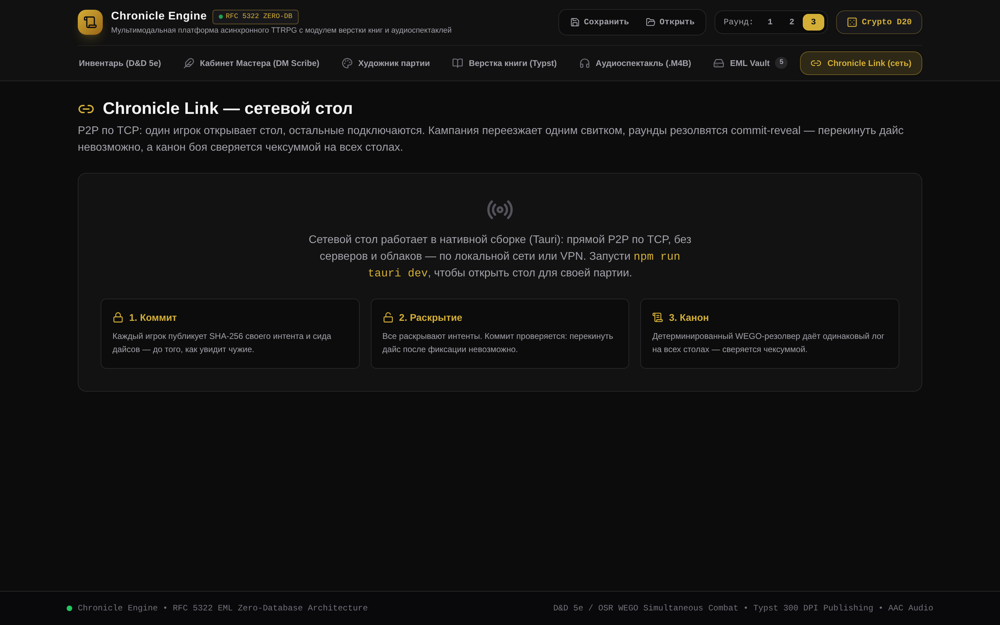
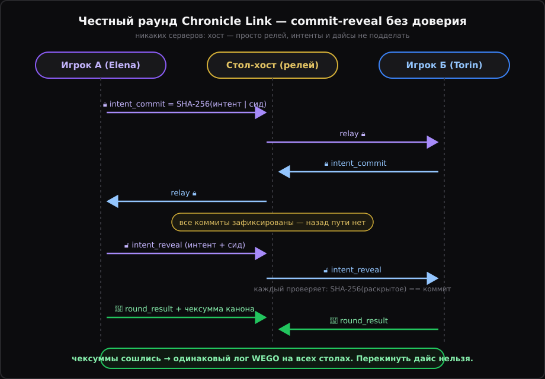
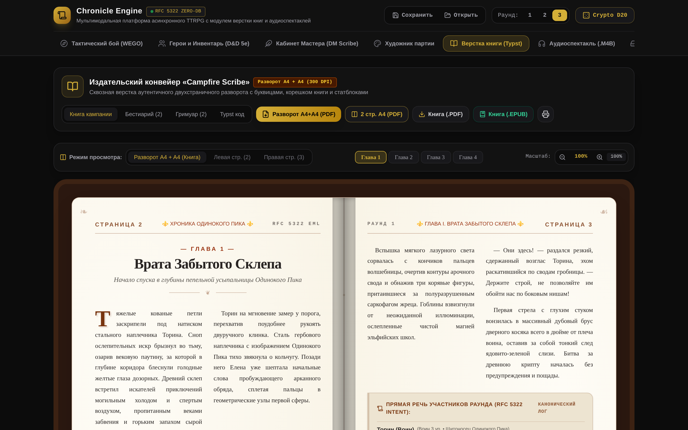
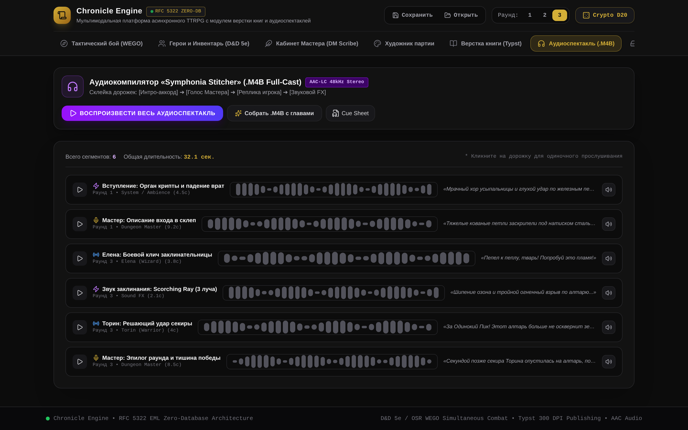
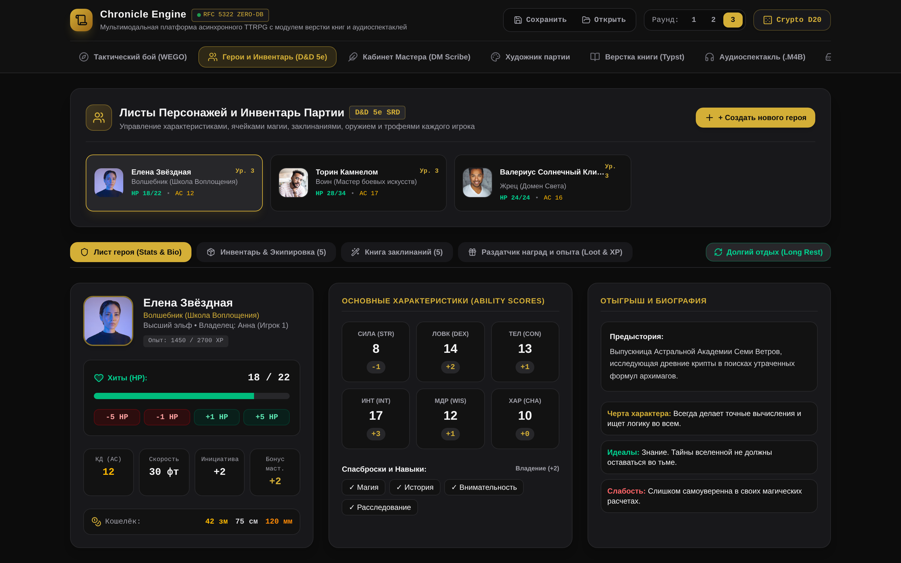

<div align="center">



# Chronicle Engine

**Настольные ролевые игры, которые помнят всё.**
WEGO-бой с одновременными ходами · криптографические дайсы, которые нельзя перекинуть ·
сетевой стол без серверов · издательство книг · аудиоспектакль — всё на твоей машине, без облаков.

[](https://github.com/kostyk348/chronicle-engine/releases)
[](https://github.com/kostyk348/chronicle-engine/actions/workflows/ci.yml)
[](#-качество-под-микроскопом)
[](LICENSE)
[](https://github.com/kostyk348/chronicle-engine/releases)

**[English](README.en.md)** · [Скачать релиз](https://github.com/kostyk348/chronicle-engine/releases) · [CHANGELOG](CHANGELOG.md)

</div>

---

## Зачем ещё один движок для НРИ

Потому что существующие платформы играют **за тебя**. Пошаговая инициатива растягивает бой на часы,
данные лежат на чужих серверах, а «кости» — это `Math.random()`, которому никто не может ни поверить, ни что-либо доказать.

Chronicle Engine построен на четырёх принципах:

- **Одновременные ходы (WEGO).** Все планируют — потом всё разрешается. Засада, контрзаклинания и дуэли реакций рождаются сами, без таблицы инициативы.
- **Криптография вместо честного слова.** Каждый d20 — это HMAC-SHA256 от сида игрока и сида мастера. По раунду нельзя перекинуть, а по логу — всегда можно проверить.
- **Ноль серверов.** Кампания — файл. Сетевой стол — прямое P2P-соединение. Ни подписок, ни аккаунтов, ни «облако временно недоступно».
- **Хроника как продукт.** Каждая сессия верстается в книгу (EPUB 3.0 / PDF / Typst) и озвучивается как аудиоспектакль. Кампания не исчезает — она выходит в свет.

## Это не таблица с фишками — это машина хроники

### ⚔️ Тактический WEGO-резолвер



Пятифазный раунд, полностью детерминированный: одинаковые интенты и сид дают **побитово одинаковый лог на любой машине**.

1. **Валидация** — мёртвые актёры и недостижимые цели отсекаются.
2. **Перемещение** — все двигаются одновременно; скорость, рывок ×2, стены и занятые клетки блокируют шаг.
3. **Действия** — оружие из данных персонажа (кости урона и бонус атаки читаются из листа), заклинания из книги: Палящий луч по уровням ячеек, Волшебная стрела с автопопаданием, Щит.
4. **Реакции** — Щит срабатывает на входящий удар у любого актёра; Dodge навязывает помеху, Help даёт союзнику преимущество.
5. **Исход** — Победа / Поражение / Отступление, и к каждому раунду — детерминированная художественная проза для хроники.

Плюс правило Fallback: цель луча пала в этом же раунде — снаряд автоматически перенаправляется по заранее заданному правилу. Как у взрослых волшебников.

**Кинематографичный реплей.** Каждый разрешённый раунд разлагается на машиночитаемые события (движение, атака, урон, лечение, исход), и тактический стол проигрывает их как спектакль: токены скользят по клеткам, дуги атак вспыхивают между противником и целью, урон всплывает цифрами, криты горят золотом. Пауза, покадровый шаг, скорость ×1–×4, мгновенная перемотка — раунд можно пересматривать, как повтор матча.

**Опыт сам течёт в листы.** За павших врагов партия получает XP (из данных существа, иначе — оценка по HP и AC) — поровну всем героям, сразу после раунда.

### 🔐 Кости, которым можно верить

Обычный онлайн-дайс — это «поверь мне». Здесь каждый бросок — commit-reveal:

```
d20 = (HMAC-SHA256(сид_игрока, сид_мастера) mod 20) + 1
```

- Игрок **не может перекинуть**: сид зафиксирован до броска.
- Мастер **не может подсмотреть**: его половина ключа раскрывается одновременно с твоей.
- Криты и провалы честные: натуральная 20 удваивает кости урона, натуральная 1 — промах вопреки любым бонусам.
- Урон, преимущество/помеха (две d20 с разными солями) и решения AI идут из детерминированного потока `HMAC(key, msg:idx)` — без смещения модуля.

### 🌐 Chronicle Link — сетевой стол без серверов



Один игрок открывает стол — остальные подключаются по локальной сети или VPN. Транспорт — TCP на чистом `std::net` в Rust-бэкенде: **ни одной сетевой библиотеки, ни одного облачного сервиса**.

- **Кампания переезжает одним свитком**: подключился — получил весь архив кампании, главы, бестиарий и состояние боя.
- **Ростер и чат за столом** — кто в сети, какими актёрами играет.
- **Честный раунд по commit-reveal**: сначала хэши интентов, потом раскрытия, потом сверка чексумм канона.
- **Честные кости за столом**: любой бросок `NdM+K` (kh/kl — преимущество и помеха) публикуется коммитом sha256(формула|сид); сид раскрывается позже, и каждый стол **пересчитывает бросок из сида** и сверяет. Подмена результата/сида/формулы ломает проверку.
- **Канон применяется, а не выбрасывается**: чужой `round_result` показывает диф (hp, позиции, статусы) и применяется к кампании одним кликом; журнал боя разъезжается по столам вместе с каноном.



| Попытка смухлевать | Что её останавливает |
|---|---|
| Игрок перекидывает дайс после неудачи | Сид зафиксирован в `intent_commit` до раскрытия; несовпадение вскрывается автоматически |
| Игрок меняет интент после чужого раскрытия | Хэш опубликованного коммита уже разослан всем — раскрытие обязано сойтись |
| Хост подыгрывает фавориту | Хост только ретранслирует; любой стол резолвит раунд сам и сверяет чексумму канона |
| «Мне повезло, у меня другой лог» | WEGO-резолвер детерминирован: расхождение чексумм = расхождение в данных, и это видно |
| Игрок «просто бросил без сети» | Бросок вне честных костей не попадает в канон и виден всем как неучтённый |

### 📖 Издательский цех



Кампания — это не лог, а **книга**: двухколоночный разворот A4 с иллюминированными буквицами, заметками Мастера и стат-блоками бестиария. Экспорт в EPUB 3.0 (со структурным оглавлением `nav.xhtml`), векторный PDF для печати и генерация исходника **Typst** для полиграфии.

### 🎭 Аудиоспектакль без единого сэмпла



Реплики персонажей синтезируются с индивидуальными тембрами, эмбиенты таверны и подземелья — чистым Web Audio API: FM-синтез, реверберация, дорожки и экспорт радиоспектакля. Всё генерируется на лету — в проекте нет ни одного бинарного аудиофайла.

### 🧙 И всё остальное, что нужно за столом



Листы персонажей D&D 5e с инвентарём и заклинаниями, кабинет Мастера с генерацией сцен, художник партии, криптографический модал дайсов и **EML Vault** — просмотрщик свитков кампании.

## 📬 Zero-Database: кампания = письмо

Вся кампания — стандартные RFC 5322 EML-свитки. Не «база данных в облаке», не проприетарный формат — **письмо**, которое открывается любым почтовым клиентом:

```
Message-ID: <round-3@chronicle.engine>
In-Reply-To: <round-2@chronicle.engine>
Subject: [Пепельная крипта] Раунд 3 — Палящий луч и рывок Торина
X-TTRPG-Round: 3
X-TTRPG-HP: elena=14/16; torin=24/32; shaman=6/28
X-TTRPG-Checksum-SHA256: 9f2c…

⚔️ Torin бьёт Goblin Ashen Shaman (Greatsword): d20=17+5=22 vs AC 13 — ПОПАДАНИЕ…
```

Цепочка `In-Reply-To` — это и есть таймлайн кампании. Проверка целостности по SHA-256 — встроена. Скачал свиток на другую машину — кампания там.

## 🚀 Установка

### Готовый релиз

Забери бинарь со страницы [Releases](https://github.com/kostyk348/chronicle-engine/releases): распаковать, запустить. Никаких установщиков с галочками и никаких зависимостей — WebView уже есть в системе.

### Сборка из исходников

Требования: [Rust](https://rustup.rs/) 1.77+, Node.js 18+.
Linux: `webkit2gtk-4.1`, `gtk3`, `librsvg` · Windows: WebView2 · macOS: WebKit.

```bash
git clone https://github.com/kostyk348/chronicle-engine
cd chronicle-engine
npm install
npm run tauri dev     # нативное окно
npm run tauri build   # бинарь + пакеты
```

Веб-режим (без нативной оболочки):

```bash
npm run dev           # Vite на :5173
```

## 🧪 Качество под микроскопом

| Слой | Проверка | Что покрывает |
|---|---|---|
| TypeScript | 51 тест (Vitest) | WEGO-резолвер: детерминизм, фазы, крит/провал, fallback, щит, dodge/help; протокол Link: канонический JSON, commit-reveal, автомат фаз, античит, движок формул NdM+K, канон-синк, события раунда, реплей-таймлайн |
| Rust | 11 тестов + clippy `-D warnings` | Транспорт: кадры, отказ oversize, релей коммит→раскрытие между двумя клиентами, свиток в welcome, суффиксы дубликатов имён, канонический JSON |
| CI | GitHub Actions | Два джоба: web (lint → test → build) и rust (cargo test → clippy). Канонический JSON зеркалится тестами с обеих сторон — расхождение канона между TS и Rust невозможно |

Воспроизводимость проверена на уровне свойств: одинаковые интенты + одинаковый сид = идентичный лог и идентичный `statePayload` (тест «детерминизм»), разные сиды = разный раунд.

## 🧠 Как устроено

| Модуль | Назначение |
|---|---|
| `src/utils/wegoResolver.ts` | Пятифазный WEGO-резолвер: движение, действия, реакции, исход + SVG-карта и проза |
| `src/utils/cryptoDice.ts` | Commit-reveal дайсы: HMAC-SHA256, поток uint32 без смещения модуля |
| `src/utils/linkProtocol.ts` | Чистая логика Link: канонический JSON, коммиты, автомат фаз (зеркало Rust) |
| `src/utils/mimeEml.ts` | RFC 5322 EML-свитки кампании |
| `src/components/NetworkLobby.tsx` | Лобби сетевого стола, фазы раунда, чат, приём свитка |
| `src/utils/epubExporter.ts` / `pdfExporter.ts` | EPUB 3.0 и PDF-верстка |
| `src/utils/audioSynthesizer.ts` | FM-синтез речи и эмбиентов (Web Audio) |
| `src/utils/desktopIO.ts` | Нативная ФС и диалоги через Tauri IPC |
| `src-tauri/src/link.rs` | Chronicle Link: TCP-транспорт, релей, кадры, коммиты (чистый `std::net`) |
| `src-tauri/src/lib.rs` | Rust-команды: файлы, диалоги, сетевые сессии |

## 🗺️ Дорожная карта

- [x] **1.0** — нативный десктоп (Tauri), WEGO-бой, EML-архитектура, издательство, аудио
- [x] **1.2** — Chronicle Link: P2P-стол, commit-reveal раунды, перенос кампании свитком
- [x] **1.3** — Живой стол: честные кости через сеть, применение канона раунда, синк журнала боя
- [x] **1.4** — Кинематографичный реплей раунда, визуальный конструктор интентов, XP в листы партии
- [ ] **1.3** — общая карта стола: перетаскивание токенов по сети, пометки Мастера в реальном времени
- [ ] **1.4** — импорт листов персонажей (D&D Beyond → JSON), генератор подземелий на данных бестиария
- [ ] **1.5** — клиент-зритель для смартфона: читать хронику и бросать дайсы с дивана

Идеи и баги — в [Issues](https://github.com/kostyk348/chronicle-engine/issues): репозиторий живой, каждый раунд движка покрыт тестом.

## ❓ FAQ

**Это замена Roll20 / Foundry?**
Нет. Это другая философия: всё состояние — на вашей машине, сеть — прямое P2P, а кампания после игры — не «дамп логов», а сверстанная книга и аудиоспектакль. Если нужна видео-доска с токенами из магазина — вам не сюда.

**Нужен ли интернет, чтобы играть?**
Нет. Одиночная игра и hot-seat работают полностью офлайн. Сеть нужна только для Chronicle Link — и то это локальный трафик между вашими машинами.

**Почему .eml, а не «нормальный формат»?**
Потому что RFC 5322 — многолетний стандарт с инструментами на каждой платформе: свиток открывается почтовым клиентом, переживает смену движка, цепочка ответов даёт таймлайн бесплатно, а контрольные суммы заголовков проверяют целостность. Проприетарный «нормальный формат» умрёт вместе с проектом — письмо не умрёт никогда.

**Кости правда нельзя подделать?**
Протокол устроен так, что после публикации коммита нельзя изменить ни интент, ни сид: раскрытие не сойдётся с хэшем, и все столы это увидят. Хост не может подыграть — он лишь ретранслирует, а детерминированный резолвер даёт одинаковый лог у всех, что сверяется чексуммами.

**Почему WEGO, а не инициатива?**
Пошаговая инициатива превращает засаду в бухгалтерию: кто первый в списке. Одновременное разрешение превращает её в драму: оба выстрелили — оба попали. Плюс это честно для OSR-песочниц, где планы важнее статов.

## 📄 Лицензия

MIT — играй, меняй, верстай. [LICENSE](LICENSE)

<div align="center">
<sub>Chronicle Engine — движок, после которого у каждой партии есть книга.</sub>
</div>
